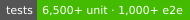
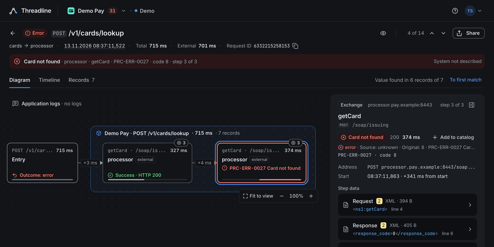
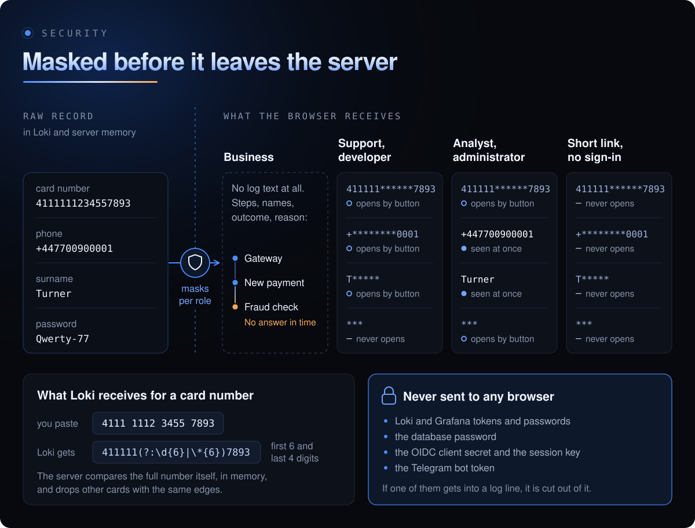
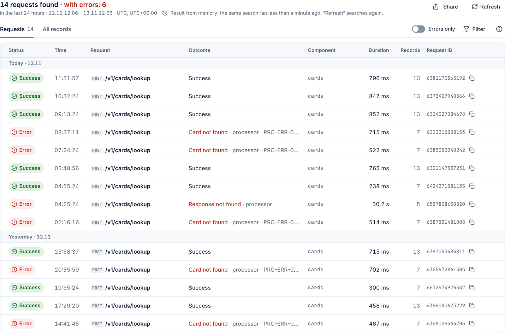
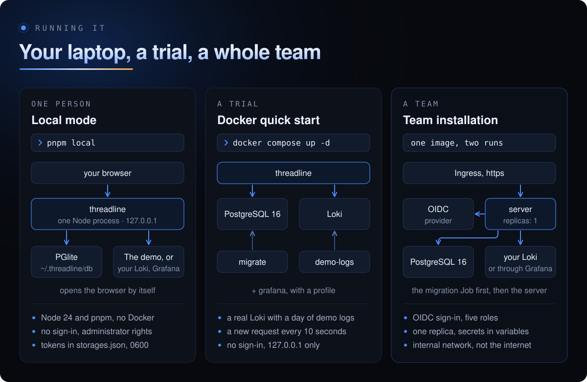

<p align="center">
  
</p>

<p align="center">
  
  
  
  
  
  
</p>

<p align="center">
  <b>English</b> · <a href="README.ru.md">Русский</a>
</p>

---

Threadline is a log viewer for one question: what happened to this request.
You paste any identifier from a case — a user ID, a card number, a phone
number, an order or transfer ID, a `correlation_id` — and a period, and it
shows every request that carried that value, across all your services, as a
flow of steps.

Under the hood it reads Loki, directly or through Grafana, stitches the records
into requests by `correlation_id`, names the systems and errors from a catalog
and masks personal data on the server, before anything reaches the browser. It
only reads logs: nothing in Loki, Grafana or your services is ever changed.

It is for the people who get the complaint first. Support need the failing
step and its reason, not a query language. Business people need the same
answer in plain words and must never see a card number. Developers and
analysts get the full technical picture of the same request: bodies, headers,
timings, "Copy as cURL", and a catalog that turns hosts and error codes into
names.

One thing to know before you install: the interface and its built-in
documentation and tutorials are in English and Russian, but much of the rest
is Russian only. The configuration reference
([config/README.md](config/README.md)), the developer notes, the comments in
the code, in the config files and in `.env.example` and the server's own log
messages are written in Russian, because Russian is the language we write in.
The Demo Pay demo project, its catalog included, is in English. Nothing in the
search, the masks or the configuration format depends on the language: your
own catalog can name systems and errors in any language.

And one more: the licence is noncommercial. Personal use, study and research
are free, a company needs a commercial licence. See
[Commercial use](#commercial-use) and [Licence](#licence).

There are two of us, [Igor Bogdanov](https://github.com/bogdanov-igor) and
[Aleksandr Ivanov](https://github.com/freihor), and the story is simple. A
complaint arrives with a phone number and a time. The answer is somewhere in
the logs of a dozen systems: a gateway, an API, a few internal services, a
couple of external partners. Getting it out means guessing labels, writing a
LogQL query per service, matching lines by timestamp and correlation ID, and
reading raw JSON until one step turns out to be the broken one. That takes an
evening, and only someone allowed to see raw logs can do it — with card
numbers and passport details in them, that is very few people. So we built a
tool that does the matching in seconds and that support and business people
can open safely, because masking happens on the server.

What we learned on the way:

- A phone number is never written the same way twice. `+447700900001`,
  `%2B447700900001`, `+44 (7700) 900-001` and `07700 900001` are one number,
  so search turns one input into every spelling instead of making a person
  guess which one this service used.
- Hiding a value on the screen is not masking: whatever reaches the browser can
  be read in its developer tools. Masks are applied in the server's response,
  per role. A full card number does not even go to Loki: the query carries the
  first 6 and last 4 digits, and the server checks the exact match itself.
- Search results need a memory budget. We measured it: 50 wide searches, four
  at a time, crashed the process at the 9th–12th search without one. With a
  budget of a third of the heap all 50 pass, and a search that hits the limit
  keeps what it found and says so.
- Grafana 8.5 proxies a data source only by its numeric ID, Grafana 13 only by
  its UID. Threadline tries the ID, falls back to the UID on a 404, and looks
  both up itself with a Viewer token.



## Quickstart

You need Docker with Compose v2.

**1.** Clone the repository and start the quick-start stack:

```sh
git clone https://github.com/bogdanov-igor/threadline.git
cd threadline/deploy/quickstart
docker compose up -d                   # the first run builds the image: a few minutes
```

**2.** Open http://localhost:8080. You land in the demo project Demo Pay,
environment "Demo", reading a real Loki: the `demo-logs` service filled it with
a day of synthetic traffic on first start and adds a new request every 10
seconds.

**3.** Click an example under the search bar, or paste a value and press
Enter. Three to start with:

| Value | What you will find |
|---|---|
| `0192f0a1-7b2c-7d3e-8f40-5a6b7c8d9e0f` | one user's requests: card, fee and a payment core decline right away; an acquirer error 500, a fraud check timeout and an identity check decline arrive with the live stream within about 15 minutes. The identity check decline is also in the 24-hour history: period 24 h |
| `4111111234557893` | card lookups, some failing with processor error `PRC-ERR-0027`; the number is masked on screen |
| `07700 900001` | one phone number in every spelling: `+447700900001`, `%2B447700900001`, `+44 (7700) 900-001` and others |

These values come every 3 minutes, and the past day's records already hold
part of them, so search finds them about a minute after startup; the default
period is 6 hours.

| Service | What it does |
|---|---|
| `threadline` | server and interface, `127.0.0.1:8080` |
| `migrate` | database schema, runs once before the server |
| `db` | PostgreSQL 16, volume `db` |
| `loki` | Loki 3.7 as a single process, 7-day retention, volume `loki` |
| `demo-logs` | writes the Demo Pay records into Loki |
| `grafana` | only with `--profile grafana`: Grafana 13 with a Loki data source, http://localhost:3000 |

Sign-in is off (`auth: off` with `THREADLINE_ALLOW_NO_LOGIN=1`), the database
password is known and the ports listen on `127.0.0.1` only: this setup is for
your own machine.

```sh
docker compose --profile grafana down      # stop; the data stays in the volumes
docker compose --profile grafana down -v   # and delete the volumes: database, logs, Grafana
```

Port taken: `THREADLINE_PORT=8081 docker compose up -d`, for Grafana
`GRAFANA_PORT=3001`. With another Grafana port, also set `publicUrl` of the
`grafana` storage in `threadline.yaml` to `http://localhost:<port>`: the "Open
in Grafana" link is built from it. After `git pull`:
`docker compose up -d --build`. Logs:
`docker compose logs -f threadline demo-logs`.

### Point it at your own logs

**Your own Loki.** In [`threadline.yaml`](deploy/quickstart/threadline.yaml),
replace the `url` of the `loki` storage; it must be reachable from the
container, so Loki on the same machine is `http://host.docker.internal:3100`.
Replace the selector of the `demo` environment with your application's labels
and describe your record format ([config/README.md](config/README.md), section
«Формат записей»). Then `docker compose restart threadline` and
`docker compose stop demo-logs`.

**Through Grafana.** `docker compose --profile grafana up -d`, sign in as
`admin` / `admin`, create a service account with the Viewer role and a token
(Administration → Users and access → Service accounts) and put it into
`deploy/quickstart/.env` as `THREADLINE_GRAFANA_TOKEN=<token>`. In
`threadline.yaml`, uncomment the `grafana` storage, set `backend: grafana` on
the environment and run `docker compose up -d`. For your own Grafana, change
its `url` in the same block.

### Or without Docker: local mode

Threadline on your own computer for one person: no PostgreSQL, no sign-in, no
`.env`. You need Node.js 24 and pnpm.

```sh
pnpm install
pnpm local                                # 8080 or the next free port, opens a browser
pnpm local -- --port 8085 --no-open       # your own port, no browser
pnpm local -- --data ~/threadline-work    # your own data folder, same as THREADLINE_DATA
```

The first run builds the interface if it is missing and writes a configuration
with Demo Pay on a simulated storage into `~/.threadline` (mode `0700`):
`threadline.yaml`, `storages.json` with storage addresses and tokens (mode
`0600`), an embedded PGlite database in `db/` with the same migrations, which
`pnpm local` applies itself, `catalog/` and `logos/`. Connect your Grafana or
Loki on the "Connect a storage" page, `/admin/storages`: "Check", then "Save",
no restart. Then create a project and an environment on the project pages.

- It listens on `127.0.0.1` only, every request runs with administrator
  rights, and it ignores `HOST`, `PORT` and the server's `THREADLINE_*`
  variables.
- Tokens stay in `storages.json`: the browser only sees "token set", and they
  never reach the log.
- A second `pnpm local` with the same folder opens the running copy instead of
  starting another. Ctrl+C stops it; `rm -rf ~/.threadline` starts over.
- After `git pull`: `pnpm install && pnpm build`, then `pnpm local`. The
  command itself builds the interface only when there is none yet.
- Your own root certificate: `NODE_EXTRA_CA_CERTS=/path/root-ca.pem pnpm local`.
  Proxy: `HTTPS_PROXY`, `NO_PROXY`.

## Who sees what

Roles come from your OIDC provider; Threadline keeps no users. Of several
roles, the strongest applies, and a person with none signs in to a "No access"
screen that says whom to ask.

| Role at the provider | In Threadline |
|---|---|
| `threadline-business` | steps, names, outcome and reason in words; no technical details, nothing unmasked, ever |
| `threadline-support` | everything technical; personal data and card number open with "Show hidden" on one request; edits errors in the catalog |
| `threadline-developer` | support, plus the whole catalog: systems, methods, errors, outcome rules, ID types |
| `threadline-analyst` | developer, plus personal data at once, secrets on one request, project settings and environments |
| `threadline-admin` | everything: creates and deletes projects, switches mask types, sets the short link lifetime |

Thirteen kinds of values can be masked: card number, secrets, card data, card
token, account number, phone, national ID, passport, surname, first name and
patronymic, date of birth, e-mail, address. First name and patronymic, date of
birth and e-mail are off until an administrator turns them on; card number and
secrets can never be turned off. On a short link nothing opens for anyone, and nobody,
administrators included, sees the service's own tokens and passwords.

## Security



Production logs hold things most people must not see, so masks, roles, sign-in
and short links are security features here, and a hole in any of them is a
vulnerability. What the code does:

- **It only reads.** The server sends Loki and Grafana GET requests only: for
  labels, counts and lines and, in Grafana, to find the data source, so a Viewer
  token is enough. What writes is the demo generator of the quick start, a
  separate command, into its own Loki.
- **Masks go on at the server**, per role, in every response. A record the mask
  fails on is replaced with a stub, and until a project's mask settings are
  read from the database every kind of value is masked. Card number and secrets
  can never be turned off.
- **Card numbers stay out of queries.** A card number you search for, 15 to 19
  digits with or without separators, goes to Loki as its first 6 and last 4
  digits, and the server checks the exact number in memory. The "Open in
  Grafana" link carries no more than the mask shows. A number inside a longer
  text, such as `pan=…`, is searched as typed.
- **Roles are checked on the server.** Every API route declares who may call
  it, and a route that declares nothing is closed. The Business role gets a
  response built from a list of allowed fields: no log text is in it.
- **No user store.** Sign-in is the OIDC authorization code flow with PKCE.
  Sessions live in server memory for 12 hours at most, behind a cookie that is
  HttpOnly, SameSite=Lax and, over https, Secure. The role is read again every
  time the token is renewed; if the provider is down, a session keeps its last
  role for 30 minutes past the end of the token, no longer.
- **Secrets come from variables only.** The configuration file names variables,
  and a token or password written into it stops the start. Local mode keeps
  them in `storages.json`, mode `0600`. They are not in the server log, and the
  service cuts its own tokens and passwords out of everything it reads from the
  storage, for administrators too.
- **Search values stay out of logs and addresses.** They travel in the request
  body. The server log has route templates instead of addresses and the type of
  an error instead of its text; the page address can hold only the ID of a
  search, a request, an operation or a link.
- **Nothing is copied.** Log records live in memory only. What the database
  gets from them is the "Unknown" inbox of undescribed errors: a host, a path
  template, a code and up to 200 characters of error text, all under every kind
  of mask, and the ID of one example request.
- **A page found in a log cannot act.** An HTML body is cleaned, gets its own
  policy and opens in a frame with an empty `sandbox`: no scripts, no network,
  no forms, no links.
- **Headers and hosts.** A Content-Security-Policy limited to its own origin, no
  framing, no referrer, `nosniff`, `no-store` on API responses. The API answers
  only to the host from `THREADLINE_PUBLIC_URL`, `localhost` and IP addresses,
  and refuses a change that comes from another origin.
- **No sign-in, no start.** Without OIDC the server refuses to start.
  `THREADLINE_ALLOW_NO_LOGIN=1` lets it, with administrator rights for everyone,
  and even then card numbers and secrets do not open.
- **No telemetry.** The server talks to your log storage, its database, your
  OIDC provider and, if you set it up, Telegram, where no record text goes. The
  page talks only to the server.

What it does not do, and does not protect from:

- **Short links open without sign-in** for anyone who has one and can reach the
  service. The address is 128 random bits, everything is masked and nothing
  opens, but hosts, codes and bodies are there. Until a link expires, its search
  conditions are in the database: phone numbers and IDs in the open, card
  numbers as the first 6 and last 4 digits.
- **`/metrics` and `/health*` are open**, and `/api/health` tells the version.
  Nothing from the logs is in them, but keep the first two off the Ingress.
- **Masks know field names and shapes.** A surname in free text, or a personal
  value in a field they have never heard of, stays visible: add your own field
  names to the project's masks.
- **Masks protect Threadline, not the logs.** Whoever opens Loki or Grafana
  directly sees raw records. The records of a search are raw in server memory
  too, until 15 minutes after its last use.
- **No audit trail.** It does not write down who searched for what or who
  pressed "Show hidden".
- **One replica on an internal network.** There is no high availability, and it
  is not meant for the open internet.

Found a hole? Report it privately, not in an issue: [SECURITY.md](SECURITY.md).

## What's inside



- **Search by any value**: user ID, card number or its mask, a phone number in
  any spelling, correlation ID, operation ID or plain text, over up to 24
  hours, in one environment or several at once — production and test, say.
- **Request list** with status, outcome, failure reason, duration and
  component, an "Errors only" switch, and "All records" with raw lines.
- **Request page**: a flow graph of the steps, a timeline, records with request
  and response bodies and headers, "Copy as cURL" for a step.
- **Operation page**: every request of one asynchronous payment or transfer —
  creation, sending, callback, polls — with how it ended and its status history.
- **Catalog** of systems, methods and errors: names, outcome rules, "What to do"
  hints, and an "Unknown" inbox of errors nobody has described yet. Edited on
  pages, as one YAML or JSON project file, from the command line or the API.
- **"Detailed" and "Brief" modes.** Brief hides hosts, codes, IDs and raw records and
  keeps the steps, names, outcome and reason. It is a view, not protection:
  protection is the masks.
- **Share links**: a short read-only link to a search, a request or an
  operation that opens without sign-in, masked, with ready text for a ticket.
  30 days by default; the link stores the search, not its results.
- **Projects and environments on pages**, a record format profile per project,
  and examples on the start page: one click fills the search bar and searches.
  The demo has five.
- **Loki directly or through Grafana** (`loki` and `loki-grafana` storages),
  tenants, tokens or Basic sign-in, any number of projects and environments.
- **Russian and English interface**, light and dark themes, installable as an
  app (PWA). Built-in documentation at `/docs` and tutorials at `/learn`.
- **Ready for a cluster**: one image of about 310 MB, health probes, Prometheus
  metrics, JSON logs to stdout, a read-only root file system, any UID.
- **Telegram**, optional: a message when a new undescribed error first shows up
  and when someone sends "Report a problem".

How the parts connect and what is stored where:


### How a search runs


The first pass counts which requests contain your value, in one-hour chunks,
newest first, without reading a single line; past 200 requests it stops and
asks you to narrow the search. The second pass fetches every record of those
requests, including the ones where the value never appears, plus five minutes
on each side. The server parses the records, groups them into requests, names
what the catalog knows, decides each request's status and reason, applies the
masks and only then answers the browser.

Loki is treated gently: at most 4 requests to one storage at a time, identical
requests at the same moment go once, the same search within 60 seconds comes
from memory, and a closed tab stops its search after 90 seconds.

## What it leaves out

- No writes and no copy of your logs. Threadline writes nothing to the
  storage; records live in memory only while a search result does, and
  retention is Loki's business.
- Loki only, for now. VictoriaLogs is planned, not built.
- No queues, Redis or workers: search jobs run inside the server process. That
  means exactly one replica. Sessions and results live in memory and a restart
  loses them; projects, catalog, settings and short links are in PostgreSQL.
- No user store and no passwords: sign-in and roles are your OIDC provider's.
- No history of what people searched for. Values are not in the server log or
  kept in the browser, and the page address can hold only an ID; only a short
  link keeps its conditions until it expires, card numbers as the first 6 and
  last 4 digits.
- No dashboards or charts of its own: that is what Grafana is for.
- No open-by-default mode. Without sign-in configured the server refuses to
  start and names what to set; `THREADLINE_ALLOW_NO_LOGIN=1` exists for your own
  machine and never belongs in a cluster.

## Running it for a team

There are three ways to run it: [local mode](#or-without-docker-local-mode) for
yourself, the [Docker quick start](#quickstart) for a trial, and an installation
for a team, which the rest of this section is about.



One image, two runs: the server (the image `CMD`, server and interface in one
process, port `8080`) and the migrations
(`node --disable-warning=ExperimentalWarning apps/server/src/cli/migrate.ts`,
no port). You need PostgreSQL 16 with a persistent volume, Loki (directly or
through Grafana with a Viewer token), an OIDC client and an Ingress with https.

**1.** Build the image from the `Dockerfile` for your nodes' architecture and
push it to your registry.

**2.** Non-secret variables into a ConfigMap, secrets into a Secret.

**3.** Run the migrations as a Job with the same image. Always the Job first,
then the Deployment: the server never changes the schema itself and stays
not ready, with `схема базы отстала` (schema is behind) in its log, until the
Job is done.

**4.** Start the server with `replicas: 1`, probes on `/health/liveness` and
`/health/readiness`, and `RollingUpdate` with `maxSurge: 1, maxUnavailable: 0`.
A starting point is `requests: { cpu: 100m, memory: 1Gi }`,
`limits: { cpu: "1", memory: 1Gi }`; the image sets
`NODE_OPTIONS=--max-old-space-size=640`, and for a bigger pod you set it to
about 60% of the limit.

**5.** Point the Ingress at the Service: keep the `Host` header, pass
`X-Forwarded-Proto: https`, set the read timeout to at least 120 seconds.

Short links open without sign-in and `/metrics` and `/health*` are open for
Prometheus and probes, so keep Threadline off the open internet and do not
publish those paths through the Ingress. The image builds from your own mirrors
too: `--build-arg NODE_IMAGE=<mirror>/node:24.22.1-alpine3.23` and
`--build-arg NPM_REGISTRY=<registry>`; `THREADLINE_REVISION` and
`THREADLINE_BUILD_DATE` put the revision and build date into
`GET /api/health`.

Check the image without a cluster: `docker build -t threadline .` then
`docker run --rm threadline` — it refuses to start, names everything missing in
one record and exits with 1. That is expected.

The full guide with manifests, metrics, alerts, memory sizing and
troubleshooting is in the [installation](apps/web/src/features/docs/content/en/docs/admin-install.md)
page. The text also reads on GitHub; pictures and links between pages work only
inside Threadline, where the same pages are at `/docs/<page>`.

## Configuration

Threadline reads one YAML file, `config/threadline.yaml` by default
(`THREADLINE_CONFIG` for another path): projects, environments, selectors,
record formats, storages, roles. Installations differ only in variables, which
win over the file. At startup the server checks the whole file and lists every
error with the path to the field. Every variable an installation uses, with its
purpose and whether it is required, is on the
[environment variables](apps/web/src/features/docs/content/en/docs/admin-variables.md)
page; [.env.example](.env.example) is the full list as a template, build and
development variables included. An empty variable counts as not set.

| Variable | What it is | When |
|---|---|---|
| `THREADLINE_DATABASE_URL` | PostgreSQL address with password | always in the image |
| `THREADLINE_GRAFANA_URL`, `THREADLINE_GRAFANA_TOKEN` | Grafana address and Viewer token | for a `loki-grafana` storage without `url`, as in the image's own config |
| `THREADLINE_LOKI_URL` | Loki address, without `/loki/api/v1` | for a `loki` storage without `url` |
| `THREADLINE_PUBLIC_URL`, `THREADLINE_OIDC_ISSUER`, `THREADLINE_OIDC_CLIENT_ID` | service address, OIDC issuer, client | all three together turn sign-in on |
| `THREADLINE_OIDC_CLIENT_SECRET`, `THREADLINE_SESSION_SECRET` | client secret, session key of 32+ characters | with sign-in on |
| `THREADLINE_CA_FILE` | root certificate for the storage and the OIDC provider | your own CA |

**Sign-in.** Any OIDC provider with discovery: Keycloak, Authentik, Okta,
Microsoft Entra ID, Zitadel, Dex. A confidential client with the authorization
code flow and PKCE S256, redirect `<THREADLINE_PUBLIC_URL>/api/auth/callback`,
post-logout `<THREADLINE_PUBLIC_URL>/logged-out`. Roles are read from
`realm_access.roles` by default, as Keycloak puts them; for other providers set
`THREADLINE_OIDC_ROLE_CLAIM`, usually `groups` or `roles`.

**Storages.** `loki-grafana` goes through Grafana's data source proxy and gives
an "Open in Grafana" link; `loki` talks to the Loki HTTP API directly, with no
sign-in, a Bearer token or Basic user and password, and `tenant` for
`X-Scope-OrgID`. Tokens and passwords never go into the file, only the names of
the variables that hold them.

File format, storages, record formats, roles and catalog:
[config/README.md](config/README.md). Catalog file:
[config/catalog/README.md](config/catalog/README.md) and
[catalog.schema.json](config/catalog/catalog.schema.json).

## Tests

Over 6,500 unit tests on Vitest across `packages/core`, `apps/server` and
`apps/web`, and over 1,000 end-to-end tests on Playwright. The end-to-end
suite builds the interface into `apps/web/dist-e2e` and starts its
own servers on an embedded PGlite database and simulated logs, with sign-in
off; it never touches a running Threadline or a real Loki. `pnpm test:e2e:pg`
runs it on PostgreSQL instead.

The server catalog tests need PostgreSQL 16: with Docker running they start
`postgres:16-alpine` on port `55432` themselves, or take
`THREADLINE_TEST_DATABASE_URL`; without Docker they are skipped with a warning.
CI runs typecheck, lint, the three unit suites, the build and the end-to-end
suite on every pull request.

## Development

Node.js 24 (`.nvmrc`) and pnpm 12.

```sh
pnpm install
pnpm dev          # interface at http://localhost:5173, /api goes to the server on :8080
pnpm typecheck
pnpm lint
pnpm test         # unit tests of core, server and web
pnpm --filter @threadline/web exec playwright install chromium   # once, for e2e
pnpm test:e2e     # Playwright end-to-end tests
pnpm build        # production build of the interface
```

The server runs straight from TypeScript on Node 24's type stripping, with no
build step of its own; Vite builds the interface. `docker-compose.yml` in the
root is for development: `docker compose up -d db` for a database,
`--profile app` for the whole service, `--profile keycloak` for a local
Keycloak with test accounts. `pnpm docs:shots` retakes the documentation
screenshots on synthetic data.

Developer notes: [docs/DEVELOPMENT.md](docs/DEVELOPMENT.md). How to
contribute: [CONTRIBUTING.md](CONTRIBUTING.md). Reporting a vulnerability:
[SECURITY.md](SECURITY.md).

## Repository layout

```text
apps/server     Fastify 5: API, search jobs, catalog and its database, sign-in,
                serving the interface
apps/web        React 19, Vite, Tailwind CSS 4, shadcn/ui, React Flow, i18next
packages/core   shared types and API, configuration schema, search, masking,
                record formats, catalog matching, outcome rules, flow model
config/         projects, environments, storages; config/catalog: the demo
                catalog and the catalog file schema
deploy/         quick start: Docker Compose, Loki and the demo logs
dev/            documentation screenshots on synthetic data (pnpm docs:shots),
                the local Keycloak realm with test accounts
docs/           developer notes, the pictures of this page
```

## Documentation

The text also reads on GitHub; pictures and links between pages work only
inside Threadline, where the same pages open at `/docs/<page>`.

| | English | Русский |
|---|---|---|
| First steps | [where to start](apps/web/src/features/docs/content/en/docs/guide-start.md) | [с чего начать](apps/web/src/features/docs/content/ru/docs/guide-start.md) |
| Search | [search](apps/web/src/features/docs/content/en/docs/guide-search.md) | [поиск](apps/web/src/features/docs/content/ru/docs/guide-search.md) |
| A request, step by step | [request page](apps/web/src/features/docs/content/en/docs/guide-request.md) | [страница запроса](apps/web/src/features/docs/content/ru/docs/guide-request.md) |
| One case, many requests | [operation](apps/web/src/features/docs/content/en/docs/guide-operation.md) | [операция](apps/web/src/features/docs/content/ru/docs/guide-operation.md) |
| Roles and masks | [roles and masks](apps/web/src/features/docs/content/en/docs/guide-roles.md) | [роли и маски](apps/web/src/features/docs/content/ru/docs/guide-roles.md) |
| Catalog | [catalog](apps/web/src/features/docs/content/en/docs/guide-catalog.md) | [справочник](apps/web/src/features/docs/content/ru/docs/guide-catalog.md) |
| Project file | [the project file, where to start](apps/web/src/features/docs/content/en/docs/file-start.md) | [файл проекта: с чего начать](apps/web/src/features/docs/content/ru/docs/file-start.md) |
| Installation | [installation](apps/web/src/features/docs/content/en/docs/admin-install.md) | [установка](apps/web/src/features/docs/content/ru/docs/admin-install.md) |
| Variables | [environment variables](apps/web/src/features/docs/content/en/docs/admin-variables.md) | [переменные окружения](apps/web/src/features/docs/content/ru/docs/admin-variables.md) |
| Sign-in | [sign-in through OIDC](apps/web/src/features/docs/content/en/docs/admin-keycloak.md) | [вход через OIDC](apps/web/src/features/docs/content/ru/docs/admin-keycloak.md) |
| Log storage | [connecting log storage](apps/web/src/features/docs/content/en/docs/admin-grafana.md) | [подключение хранилища логов](apps/web/src/features/docs/content/ru/docs/admin-grafana.md) |
| Local mode | [local mode](apps/web/src/features/docs/content/en/docs/admin-local.md) | [локальный режим](apps/web/src/features/docs/content/ru/docs/admin-local.md) |
| Backup | [backup](apps/web/src/features/docs/content/en/docs/admin-backup.md) | [резервная копия](apps/web/src/features/docs/content/ru/docs/admin-backup.md) |
| How it is built | [what Threadline is made of](apps/web/src/features/docs/content/en/docs/arch-overview.md) | [из чего состоит Threadline](apps/web/src/features/docs/content/ru/docs/arch-overview.md) |
| How a search runs | [what happens after “Find”](apps/web/src/features/docs/content/en/docs/arch-request.md) | [что происходит после «Найти»](apps/web/src/features/docs/content/ru/docs/arch-request.md) |

## Languages

The interface, the built-in documentation and the tutorials are in Russian and
English today. Another language can be added quickly on request, Uzbek or any
other: write to us at the address below or open an issue.

It is quick because of how the text is kept. Interface strings are JSON files,
one per language next to each feature, and a test keeps the languages in step: a
missing key, a wrong plural form or a lost placeholder fails it. The
documentation is Markdown, a folder per language. Names in the catalog are your
own text and can be in any language, whatever the interface speaks.

## Commercial use

A company that wants to use Threadline writes to us:
[bogdanov.ig.alex@gmail.com](mailto:bogdanov.ig.alex@gmail.com). There are two
of us and we wrote it, so you talk to the people who change the code.

- **Something is missing for your case**: a log format, a storage, a report, an
  integration. We will build it.
- **Rollout and the catalog.** We help to install it and to fill the catalog:
  the names of your systems, methods and errors are what turn a flow of calls
  into an answer.
- **A trial on your own logs** can be agreed before anything else.

Tell us where your logs are, Loki or something else, and what one record looks
like. Invented values are enough: please never send real log lines, tokens or
personal data. Bugs and ideas go to
[GitHub issues](https://github.com/bogdanov-igor/threadline/issues).

## Licence

[PolyForm Noncommercial 1.0.0](LICENSE) © 2026
**[Igor Bogdanov](https://github.com/bogdanov-igor)** ·
**[Aleksandr Ivanov](https://github.com/freihor)**

The source is available: you can read it, run it and change it. This is not an
open-source licence, though: it covers noncommercial purposes only.

- **Free**: personal use without a commercial aim, such as study, research,
  experiments and hobby projects; charities, schools and other educational
  institutions, public research, public safety or health, environmental
  protection and government organizations. You may change it and pass it on for
  the same purposes, together with the licence text or its address and the
  `Required Notice:` line from the top of the [LICENSE](LICENSE) file.
- **Needs a commercial licence**: use by a company or for a company, internal
  use included. See [Commercial use](#commercial-use).

The first published commits, up to 0.1.0, were under the MIT licence, and for
copies taken then this stays true. From 0.2.0 on the licence above applies. This
is a summary; the [licence text](LICENSE) decides.
