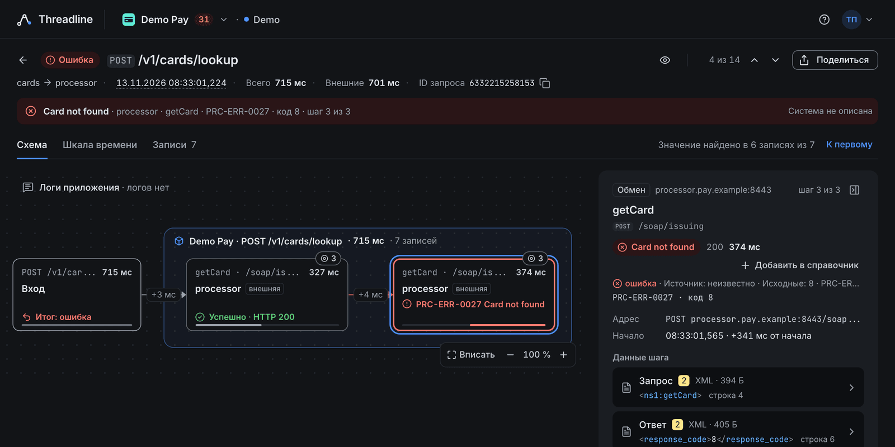
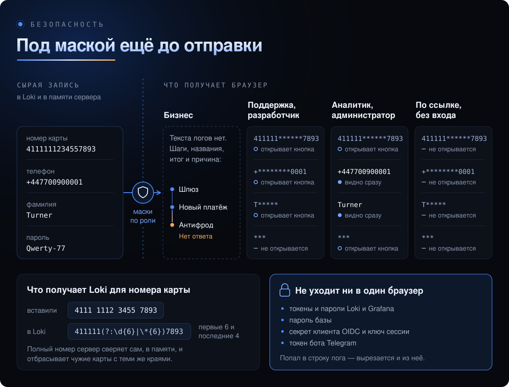
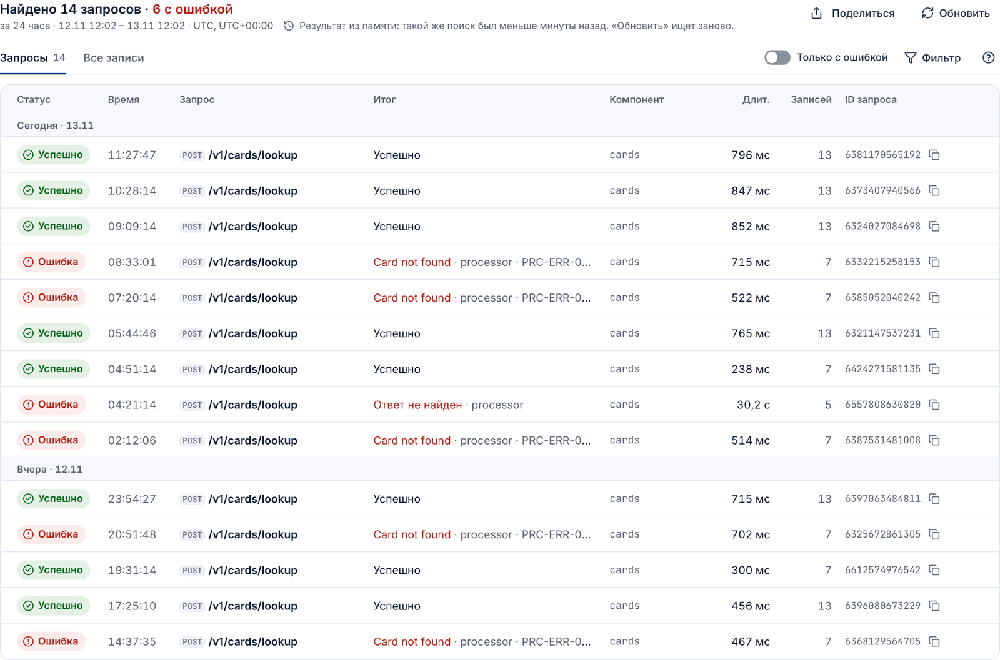
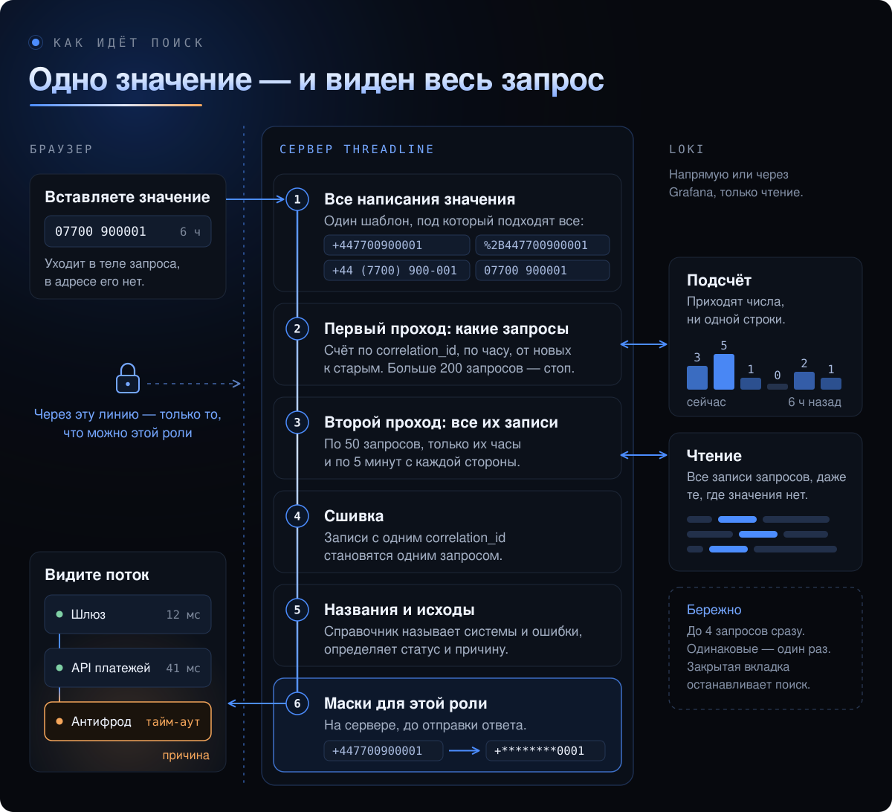
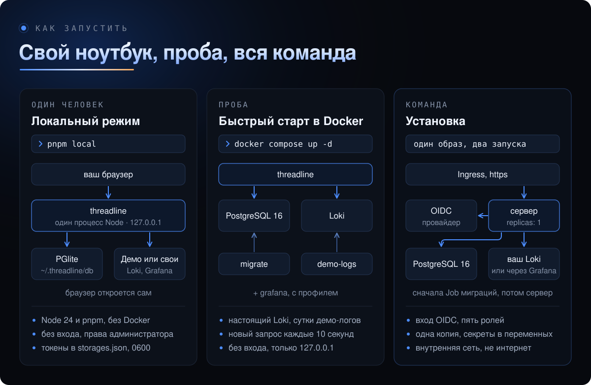

<p align="center">
  
</p>

<p align="center">
  
  
  
  
  
  
</p>

<p align="center">
  <a href="README.md">English</a> · <b>Русский</b>
</p>

---

Threadline — просмотрщик логов, который отвечает на один вопрос: что случилось
с этим запросом. Вставляете любой идентификатор из обращения — id
пользователя, номер карты, телефон, id заказа или перевода, `correlation_id` —
и период, и видите каждый запрос, в котором было это значение, во всех
сервисах сразу, шаг за шагом.

Под капотом он читает Loki, напрямую или через Grafana, сшивает записи в
запросы по `correlation_id`, называет системы и ошибки по справочнику и
маскирует персональные данные на сервере, до того как что-то попадёт в
браузер. Логи он только читает: ни в Loki, ни в Grafana, ни в ваших сервисах
ничего не меняется.

Он для тех, к кому жалоба приходит первой. Поддержке нужен шаг, на котором всё
сломалось, и причина, а не язык запросов. Бизнесу нужен тот же ответ простыми
словами, и номер карты он видеть не должен никогда. Разработчики и аналитики
видят тот же запрос целиком: тела, заголовки, время, «Скопировать как cURL» и
справочник, который превращает хосты и коды ошибок в названия.

Сразу о лицензии: она некоммерческая. Личное использование, учёба и
исследования бесплатны, компании нужна коммерческая лицензия. Подробно —
[«Коммерческое использование»](#коммерческое-использование) и
[«Лицензия»](#лицензия).

Нас двое, [Игорь Богданов](https://github.com/bogdanov-igor) и
[Александр Иванов](https://github.com/freihor), и история простая. Приходит
обращение: телефон и время. Ответ лежит где-то в логах десятка систем — шлюз,
API, несколько внутренних сервисов, пара внешних партнёров. Чтобы его достать,
надо угадать метки, написать LogQL под каждый сервис, сопоставить строки по
времени и correlation_id и читать сырой JSON, пока не найдётся сломанный шаг.
На это уходит вечер, и сделать это может только тот, кому можно смотреть сырые
логи, — а с номерами карт и паспортами внутри таких людей немного. Поэтому мы
сделали инструмент, который сводит всё за секунды и который не страшно открыть
поддержке и бизнесу: маскирование происходит на сервере.

Чему мы научились по ходу:

- Телефон каждый сервис пишет по-своему. `+447700900001`, `%2B447700900001`,
  `+44 (7700) 900-001` и `07700 900001` — один номер, поэтому поиск сам
  разворачивает одно значение во все написания, а не заставляет человека
  угадывать, как его записал этот сервис.
- Спрятать значение на экране — не значит замаскировать: всё, что пришло в
  браузер, читается в инструментах разработчика. Маски накладываются в ответе
  сервера, по роли. Полный номер карты не уходит даже в Loki: в запросе только
  первые 6 и последние 4 цифры, точное совпадение сервер проверяет сам.
- Результатам поиска нужен бюджет памяти. Мы замерили: 50 широких поисков по
  четыре одновременно без бюджета роняли процесс на 9–12-м. С бюджетом в треть
  кучи проходят все 50, а поиск, упёршийся в предел, оставляет найденное и
  честно об этом пишет.
- Grafana 8.5 проксирует источник только по числовому id, Grafana 13 — только
  по uid. Threadline пробует id, при 404 переходит на uid и сам узнаёт оба —
  хватает токена роли Viewer.



## Быстрый старт

Нужен Docker с Compose v2.

**1.** Склонируйте репозиторий и поднимите стенд быстрого старта:

```sh
git clone https://github.com/bogdanov-igor/threadline.git
cd threadline/deploy/quickstart
docker compose up -d                   # первый запуск собирает образ: несколько минут
```

**2.** Откройте http://localhost:8080. Откроется демо-проект Demo Pay, среда
«Demo», записи читаются из настоящего Loki: сервис `demo-logs` при первом
старте пишет туда сутки синтетических запросов и дальше добавляет новый каждые
10 секунд.

**3.** Нажмите на пример под строкой поиска или вставьте значение и нажмите
Enter. Для начала — три:

| Значение | Что найдётся |
|---|---|
| `0192f0a1-7b2c-7d3e-8f40-5a6b7c8d9e0f` | запросы одного пользователя: карта, комиссия и отказ платёжного ядра сразу; ошибка 500 эквайера, тайм-аут проверки мошенничества и отказ проверки личности приходят с живым потоком минут за 15. Отказ проверки личности есть и в истории за сутки: период 24 ч |
| `4111111234557893` | запросы «Cards by tokens» (`/v1/cards/lookup`), часть — с отказом процессинга `PRC-ERR-0027`; номер на экране под маской |
| `07700 900001` | один телефон во всех написаниях: `+447700900001`, `%2B447700900001`, `+44 (7700) 900-001` и другие |

Эти значения приходят раз в 3 минуты, часть из них уже есть в записях за
прошедшие сутки, поэтому поиск находит их примерно через минуту после старта;
период по умолчанию — 6 часов.

| Сервис | Что делает |
|---|---|
| `threadline` | сервер и интерфейс, `127.0.0.1:8080` |
| `migrate` | схема базы, один раз перед сервером |
| `db` | PostgreSQL 16, том `db` |
| `loki` | Loki 3.7 одним процессом, срок хранения 7 дней, том `loki` |
| `demo-logs` | пишет записи Demo Pay в Loki |
| `grafana` | только с `--profile grafana`: Grafana 13 с источником Loki, http://localhost:3000 |

Вход выключен (`auth: off` с `THREADLINE_ALLOW_NO_LOGIN=1`), пароль базы
известен, порты открыты только на `127.0.0.1`: это стенд для своей машины.

```sh
docker compose --profile grafana down      # остановить, данные остаются в томах
docker compose --profile grafana down -v   # и удалить тома: базу, логи, Grafana
```

Порт занят: `THREADLINE_PORT=8081 docker compose up -d`, для Grafana
`GRAFANA_PORT=3001`. С другим портом Grafana поставьте и `publicUrl` хранилища
`grafana` в `threadline.yaml`: `http://localhost:<порт>`, из него строится
ссылка «Открыть в Grafana». После `git pull`: `docker compose up -d --build`.
Журналы: `docker compose logs -f threadline demo-logs`.

### Подключить свои логи

**Свой Loki.** В [`threadline.yaml`](deploy/quickstart/threadline.yaml)
замените `url` хранилища `loki`; адрес должен открываться из контейнера, так
что Loki на этой же машине — `http://host.docker.internal:3100`. Селектор среды
`demo` замените метками своего приложения и опишите формат записей
([config/README.md](config/README.md), «Формат записей»). Затем
`docker compose restart threadline` и `docker compose stop demo-logs`.

**Через Grafana.** `docker compose --profile grafana up -d`, войдите как
`admin` / `admin`, создайте сервисный аккаунт с ролью Viewer и токен
(Administration → Users and access → Service accounts) и запишите его в
`deploy/quickstart/.env` строкой `THREADLINE_GRAFANA_TOKEN=<токен>`. В
`threadline.yaml` раскомментируйте хранилище `grafana`, у среды поставьте
`backend: grafana` и выполните `docker compose up -d`. Своя Grafana — свой
`url` в том же блоке.

### Или без Docker: локальный режим

Threadline на своём компьютере для одного человека: без PostgreSQL, без входа,
без `.env`. Нужны Node.js 24 и pnpm.

```sh
pnpm install
pnpm local                                # 8080 или следующий свободный, откроет браузер
pnpm local -- --port 8085 --no-open       # свой порт, без браузера
pnpm local -- --data ~/threadline-work    # своя папка данных, то же THREADLINE_DATA
```

Первый запуск собирает интерфейс, если его нет, и пишет в `~/.threadline`
(права `0700`) конфигурацию с Demo Pay на имитации хранилища:
`threadline.yaml`, `storages.json` с адресами и токенами хранилищ (права
`0600`), встроенную базу PGlite в `db/` с теми же миграциями, их `pnpm local`
применяет сам, `catalog/` и `logos/`. Свою Grafana или Loki подключите на
странице «Подключить хранилище» (`/admin/storages`): «Проверить», затем
«Сохранить», без перезапуска. Дальше проект и среда создаются на страницах
проектов.

- Слушает только `127.0.0.1`, любой запрос выполняется с правами
  администратора, а `HOST`, `PORT` и серверные `THREADLINE_*` не читает.
- Токены лежат только в `storages.json`: в браузер приходит «токен задан», в
  журнал они не попадают.
- Второй `pnpm local` с той же папкой не запускает копию, а открывает
  работающую. Остановка — Ctrl+C, начать заново — `rm -rf ~/.threadline`.
- После `git pull`: `pnpm install && pnpm build`, затем `pnpm local`. Сама
  команда собирает интерфейс, только когда его ещё нет.
- Свой корневой сертификат: `NODE_EXTRA_CA_CERTS=/путь/root-ca.pem pnpm local`.
  Прокси: `HTTPS_PROXY`, `NO_PROXY`.

## Кто что видит

Роли приходят от вашего провайдера OIDC, своих пользователей у Threadline нет.
Из нескольких ролей действует сильнейшая, а человек без роли входит и видит
экран «Нет доступа» с тем, к кому обратиться.

| Роль у провайдера | В Threadline |
|---|---|
| `threadline-business` | шаги, названия, итог и причина словами; без технических подробностей, ничего не открывается — никогда |
| `threadline-support` | всё техническое; персональные данные и номер карты открываются кнопкой «Показать скрытое» на одном запросе; правит ошибки в справочнике |
| `threadline-developer` | то же, что поддержка, плюс весь справочник: системы, методы, ошибки, правила итога, типы id |
| `threadline-analyst` | то же, что разработчик, плюс персональные данные сразу, секреты на одном запросе, настройки проекта и среды |
| `threadline-admin` | всё: создаёт и удаляет проекты, включает и выключает виды масок, задаёт срок коротких ссылок |

Маскировать можно 13 видов значений: номер карты, секреты, данные карты, токен
карты, номер счёта, телефон, личный номер, паспорт, фамилию, имя и отчество,
дату рождения, e-mail, адрес. Имя и отчество, дата рождения и e-mail
выключены, пока их не включит администратор; номер карты и секреты не
выключаются никогда. На
короткой ссылке не открывается ничего и ни для кого, а токенов и паролей самого
сервиса не видит никто, даже администратор.

## Безопасность



В логах работающих систем есть то, что большинству видеть нельзя, поэтому маски,
роли, вход и короткие ссылки здесь — функции безопасности, а дыра в любой из них
— уязвимость. Что делает код:

- **Только читает.** В Loki и Grafana сервер шлёт только запросы GET: за метками,
  счётчиками и строками, а в Grafana ещё чтобы найти источник, поэтому хватает
  токена роли Viewer. Пишет генератор демо-логов быстрого старта, отдельная
  команда, в свой же Loki.
- **Маски накладывает сервер**, по роли, в каждом ответе. Запись, на которой
  маска сломалась, заменяется заглушкой, а пока настройки масок проекта не
  прочитаны из базы, скрыты все виды значений. Номер карты и секреты не
  выключаются никогда.
- **Номеров карт в запросах нет.** Номер карты из поиска, 15–19 цифр слитно или
  с разделителями, уходит в Loki первыми 6 и последними 4 цифрами, точное
  совпадение сервер проверяет сам, в памяти. В ссылке «Открыть в Grafana» не
  больше, чем показала бы маска. Номер внутри длинного текста, например
  `pan=…`, ищется как введён.
- **Роли проверяет сервер.** Каждый маршрут API объявляет, кому он доступен,
  необъявленный закрыт. Ответ для роли «Бизнес» собирается из списка
  разрешённых полей: текста логов в нём нет.
- **Своих пользователей нет.** Вход — authorization code flow OIDC с PKCE.
  Сессии живут в памяти сервера не дольше 12 часов, cookie — HttpOnly,
  SameSite=Lax, по https ещё и Secure. Роль читается заново при каждом
  обновлении токена; если провайдер не отвечает, последняя роль действует ещё 30
  минут после конца токена, не дольше.
- **Секреты только из переменных.** В файле настроек — имена переменных, а с
  токеном или паролем внутри сервер не запустится. В локальном режиме они лежат
  в `storages.json` с правами `0600`. В журнале сервера их нет, а свои токены и
  пароли сервис вырезает из всего, что читает из хранилища, даже для
  администратора.
- **Значений поиска нет ни в журнале, ни в адресе.** Они уходят в теле запроса.
  В журнале шаблоны маршрутов вместо адресов и вид ошибки вместо её текста, в
  адресе страницы бывает только id поиска, запроса, операции или ссылки.
- **Ничего не копируется.** Записи логов живут только в памяти. В базу из них
  попадает раздел «Неизвестное» с неописанными ошибками: хост, шаблон пути, код
  и до 200 символов текста ошибки, всё под масками всех видов, и id одного
  запроса-примера.
- **Страница из лога ничего не сделает.** Тело HTML очищается, получает свою
  политику и открывается в рамке с пустым `sandbox`: ни скриптов, ни сети, ни
  форм, ни ссылок.
- **Заголовки и имена.** Content-Security-Policy только на свой адрес, запрет
  рамок, без Referer, `nosniff`, `no-store` на ответах API. API отвечает только
  на имя из `THREADLINE_PUBLIC_URL`, `localhost` и IP-адреса и отклоняет
  изменяющие запросы с чужого сайта.
- **Без входа не запустится.** Без OIDC сервер отказывается стартовать.
  `THREADLINE_ALLOW_NO_LOGIN=1` это разрешает, у всех тогда права
  администратора, но номера карт и секреты не открываются и тогда.
- **Телеметрии нет.** Сервер обращается к вашему хранилищу логов, своей базе,
  вашему провайдеру OIDC и, если его настроить, к Telegram, куда текст записей
  не уходит. Страница обращается только к серверу.

Чего он не делает и от чего не защищает:

- **Короткие ссылки открываются без входа** у любого, у кого есть ссылка и
  доступ к сервису. В адресе 128 случайных бит, всё под маской и ничего не
  открывается, но хосты, коды и тела видны. Пока срок ссылки не вышел, её
  условия лежат в базе: телефоны и id открыто, номер карты — первыми 6 и
  последними 4 цифрами.
- **`/metrics` и `/health*` открыты**, а `/api/health` называет версию. Данных
  из логов в них нет, но первые два через Ingress не публикуйте.
- **Маски знают имена полей и вид значений.** Фамилия в свободном тексте или
  личное значение в поле, о котором маски не слышали, останется видно:
  добавьте свои имена полей в маски проекта.
- **Маски защищают Threadline, а не логи.** Кто открывает Loki или Grafana
  напрямую, видит сырые записи. Записи поиска лежат без масок и в памяти
  сервера, пока не пройдёт 15 минут с последнего обращения.
- **Журнала действий нет.** Не записывается ни кто что искал, ни кто нажал
  «Показать скрытое».
- **Одна копия во внутренней сети.** Отказоустойчивости нет, и для открытого
  интернета он не предназначен.

Нашли дыру — сообщите приватно, а не в issue: [SECURITY.md](SECURITY.md).

## Что внутри



- **Поиск по любому значению**: id пользователя, номер карты или его маска,
  телефон в любом написании, correlation_id, id операции или просто текст, за
  период до 24 часов, в одной среде или сразу в нескольких — например, в проде
  и тесте.
- **Список запросов** со статусом, итогом, причиной ошибки, длительностью и
  компонентом, переключатель «Только с ошибкой» и «Все записи» с сырыми
  строками.
- **Страница запроса**: граф шагов, шкала времени, записи с телами и
  заголовками запросов и ответов, «Скопировать как cURL» для шага.
- **Страница операции**: все запросы одного асинхронного платежа или перевода —
  создание, отправка, обратный вызов, опросы — с тем, чем всё кончилось, и
  ходом статусов.
- **Справочник** систем, методов и ошибок: названия, правила итога, подсказки
  «Что делать» и раздел «Неизвестное» с ошибками, которые ещё никто не описал.
  Правится на страницах, одним файлом проекта в YAML или JSON, командой и через
  API.
- **Режимы «Подробно» и «Кратко».** Краткий убирает хосты, коды, id и сырые
  записи и оставляет шаги, названия, итог и причину. Это вид, а не защита:
  защищают маски.
- **Короткие ссылки**: ссылка на поиск, запрос или операцию только для чтения,
  открывается без входа, значения под маской, есть готовый текст для тикета.
  Живёт 30 дней по умолчанию и хранит условия поиска, а не результаты.
- **Проекты и среды на страницах**, профиль формата записей у каждого проекта
  и примеры на стартовой странице: один щелчок заполняет строку и ищет. В
  демо их пять.
- **Loki напрямую или через Grafana** (хранилища `loki` и `loki-grafana`),
  арендаторы, токен или вход по имени и паролю, сколько угодно проектов и сред.
- **Интерфейс на русском и английском**, светлая и тёмная темы, установка как
  приложение (PWA). Встроенная документация — `/docs`, обучение — `/learn`.
- **Готов к кластеру**: один образ около 310 МБ, пробы, метрики Prometheus,
  журнал JSON в stdout, корневая файловая система только для чтения, любой UID.
- **Telegram**, по желанию: сообщение, когда впервые появляется неописанная
  ошибка и когда кто-то отправляет «Сообщить о проблеме».

Как связаны части и что где лежит:


### Как идёт поиск



Первый проход считает, в каких запросах есть ваше значение, кусками по часу,
от новых к старым, не читая ни одной строки; больше 200 запросов — и поиск
останавливается и просит сузить условия. Второй проход забирает все записи
этих запросов, в том числе те, где значения нет, с запасом по пять минут с
каждой стороны. Сервер разбирает записи, собирает их в запросы, называет то,
что знает справочник, определяет статус и причину каждого запроса,
накладывает маски и только потом отвечает браузеру.

Loki он бережёт: не больше 4 запросов к одному хранилищу одновременно,
одинаковые одновременные запросы уходят один раз, тот же поиск в течение 60
секунд берётся из памяти, а закрытая вкладка останавливает свой поиск через 90
секунд.

## Чего здесь нет

- Ни записи в хранилище, ни своей копии логов. Threadline ничего не пишет в
  Loki, строки живут в памяти, пока жив результат поиска, а срок хранения —
  забота Loki.
- Других хранилищ, кроме Loki, пока нет: поддержка VictoriaLogs в планах.
- Очередей, Redis и воркеров: задания поиска идут внутри процесса сервера.
  Поэтому копия сервера ровно одна. Сессии и результаты живут в памяти и
  пропадают при перезапуске; проекты, справочник, настройки и короткие ссылки —
  в PostgreSQL.
- Своих пользователей и паролей: вход и роли — у вашего провайдера OIDC.
- Истории того, что искали. Значений нет ни в журнале сервера, ни в хранилище
  браузера, а в адресе страницы бывает только id; условия хранит только короткая
  ссылка до конца срока, номер карты — первыми 6 и последними 4 цифрами.
- Своих дашбордов и графиков: для этого есть Grafana.
- Режима «открыто всем по умолчанию». Без настроенного входа сервер не
  запускается и называет, что задать; `THREADLINE_ALLOW_NO_LOGIN=1` — для своей
  машины, в кластере ему не место.

## Развёртывание для команды

Запустить можно тремя способами: [локальный режим](#или-без-docker-локальный-режим)
для себя, [быстрый старт в Docker](#быстрый-старт) на пробу и установка для
команды, о ней остальная часть раздела.



Один образ, два запуска: сервер (`CMD` образа, сервер и интерфейс в одном
процессе, порт `8080`) и миграции
(`node --disable-warning=ExperimentalWarning apps/server/src/cli/migrate.ts`,
без порта). Нужны PostgreSQL 16 с постоянным томом, Loki (напрямую или через
Grafana с токеном роли Viewer), клиент у провайдера OIDC и Ingress с https.

**1.** Соберите образ из `Dockerfile` под архитектуру узлов и положите в свой
реестр.

**2.** Несекретные переменные — в ConfigMap, секреты — в Secret.

**3.** Выполните миграции Job с тем же образом. Всегда сначала Job, потом
Deployment: сервер схему сам не меняет и, пока Job не прошёл, не готов и пишет
в журнал `схема базы отстала`.

**4.** Запустите сервер: `replicas: 1`, пробы на `/health/liveness` и
`/health/readiness`, `RollingUpdate` с `maxSurge: 1, maxUnavailable: 0`. Для
начала — `requests: { cpu: 100m, memory: 1Gi }`,
`limits: { cpu: "1", memory: 1Gi }`; образ задаёт
`NODE_OPTIONS=--max-old-space-size=640`, а для пода побольше поставьте около
60% его лимита.

**5.** Направьте Ingress на Service: сохраняйте заголовок `Host`, передавайте
`X-Forwarded-Proto: https`, таймаут чтения — не меньше 120 секунд.

Короткие ссылки открываются без входа, а `/metrics` и `/health*` открыты для
Prometheus и проб, поэтому не выставляйте Threadline в открытый интернет и не
публикуйте эти пути через Ingress. Образ собирается и из своих зеркал:
`--build-arg NODE_IMAGE=<зеркало>/node:24.22.1-alpine3.23` и
`--build-arg NPM_REGISTRY=<реестр>`; `THREADLINE_REVISION` и
`THREADLINE_BUILD_DATE` кладут ревизию и дату сборки в `GET /api/health`.

Проверить образ без кластера: `docker build -t threadline .`, затем
`docker run --rm threadline` — он откажется стартовать, одной записью назовёт
всё, чего не хватает, и выйдет с кодом 1. Так и должно быть.

Полное руководство с манифестами, метриками, оповещениями, расчётом памяти и
разбором ошибок — на странице
[«Установка»](apps/web/src/features/docs/content/ru/docs/admin-install.md).
Текст читается и на GitHub, картинки и ссылки между страницами работают только
в самом Threadline, там те же страницы по адресу `/docs/<страница>`.

## Настройка

Threadline читает один YAML-файл, по умолчанию `config/threadline.yaml`
(другой путь — `THREADLINE_CONFIG`): проекты, среды, селекторы, форматы
записей, хранилища, роли. Установки отличаются только переменными, а
переменные главнее файла. На старте сервер проверяет файл целиком и
перечисляет все ошибки с путём к полю. Все переменные установки с назначением
и обязательностью — на странице
[«Переменные окружения»](apps/web/src/features/docs/content/ru/docs/admin-variables.md);
полный список вместе с переменными сборки и разработки — шаблон
[.env.example](.env.example). Пустая переменная считается незаданной.

| Переменная | Что это | Когда |
|---|---|---|
| `THREADLINE_DATABASE_URL` | адрес PostgreSQL с паролем | в образе всегда |
| `THREADLINE_GRAFANA_URL`, `THREADLINE_GRAFANA_TOKEN` | адрес Grafana и токен роли Viewer | для хранилища `loki-grafana` без `url` — такое в настройке образа |
| `THREADLINE_LOKI_URL` | адрес Loki без `/loki/api/v1` | для хранилища `loki` без `url` |
| `THREADLINE_PUBLIC_URL`, `THREADLINE_OIDC_ISSUER`, `THREADLINE_OIDC_CLIENT_ID` | адрес сервиса, издатель OIDC, клиент | все три вместе включают вход |
| `THREADLINE_OIDC_CLIENT_SECRET`, `THREADLINE_SESSION_SECRET` | секрет клиента, ключ сессии от 32 символов | при включённом входе |
| `THREADLINE_CA_FILE` | корневой сертификат для хранилища и провайдера OIDC | свой удостоверяющий центр |

**Вход.** Подходит любой провайдер OIDC с discovery: Keycloak, Authentik,
Okta, Microsoft Entra ID, Zitadel, Dex. Нужен конфиденциальный клиент с
authorization code flow и PKCE S256, адрес возврата
`<THREADLINE_PUBLIC_URL>/api/auth/callback`, адрес после выхода
`<THREADLINE_PUBLIC_URL>/logged-out`. Роли по умолчанию читаются из
`realm_access.roles`, как их кладёт Keycloak; для других провайдеров задайте
`THREADLINE_OIDC_ROLE_CLAIM`, обычно `groups` или `roles`.

**Хранилища.** `loki-grafana` ходит через прокси источника Grafana и даёт
ссылку «Открыть в Grafana»; `loki` обращается к HTTP API Loki напрямую: без
входа, с токеном Bearer или именем и паролем Basic, `tenant` — для
`X-Scope-OrgID`. Токены и пароли в файл не пишутся, только имена переменных, в
которых они лежат.

Формат файла, хранилища, форматы записей, роли и справочник:
[config/README.md](config/README.md). Файл справочника:
[config/catalog/README.md](config/catalog/README.md) и
[catalog.schema.json](config/catalog/catalog.schema.json).

## Тесты

Больше 6 500 модульных тестов на Vitest в `packages/core`, `apps/server` и
`apps/web` и больше 1 000 сквозных тестов на Playwright. Сквозной набор собирает интерфейс в `apps/web/dist-e2e` и поднимает
свои серверы на встроенной базе PGlite и имитации логов, с выключенным входом;
работающий Threadline и настоящий Loki он не трогает. `pnpm test:e2e:pg`
гоняет его на PostgreSQL.

Тестам справочника на сервере нужен PostgreSQL 16: при запущенном Docker они
сами поднимают `postgres:16-alpine` на порту `55432` или берут
`THREADLINE_TEST_DATABASE_URL`; без Docker пропускаются с предупреждением. CI
на каждом пулл-реквесте гоняет проверку типов, линтер, три модульных набора,
сборку и сквозной набор.

## Разработка

Node.js 24 (`.nvmrc`) и pnpm 12.

```sh
pnpm install
pnpm dev          # интерфейс на http://localhost:5173, /api проксируется на сервер :8080
pnpm typecheck
pnpm lint
pnpm test         # модульные тесты core, server и web
pnpm --filter @threadline/web exec playwright install chromium   # один раз, для e2e
pnpm test:e2e     # сквозные тесты на Playwright
pnpm build        # сборка интерфейса для прода
```

Сервер запускается прямо из TypeScript на встроенном в Node 24 type
stripping, своей сборки у него нет; интерфейс собирает Vite. `docker-compose.yml`
в корне — для разработки: `docker compose up -d db` — база,
`--profile app` — сервис целиком, `--profile keycloak` — локальный Keycloak с
тестовыми учётками. `pnpm docs:shots` переснимает скриншоты документации на
синтетических данных.

Заметки для разработчика: [docs/DEVELOPMENT.md](docs/DEVELOPMENT.md). Как
предложить правку: [CONTRIBUTING.md](CONTRIBUTING.md). Как сообщить об
уязвимости: [SECURITY.md](SECURITY.md).

## Раскладка репозитория

```text
apps/server     Fastify 5: API, задания поиска, справочник и его база, вход,
                раздача интерфейса
apps/web        React 19, Vite, Tailwind CSS 4, shadcn/ui, React Flow, i18next
packages/core   общие типы и API, схема настройки, поиск, маскирование,
                форматы записей, справочник, правила итога, модель потока
config/         проекты, среды, хранилища; config/catalog — демо-справочник
                и схема файла справочника
deploy/         быстрый старт: Docker Compose, Loki и демо-логи
dev/            скриншоты документации на синтетических данных (pnpm docs:shots),
                локальный realm Keycloak с тестовыми учётками
docs/           заметки для разработчика, картинки этой страницы
```

## Документация

Текст читается и на GitHub, картинки и ссылки между страницами работают только
в самом Threadline, там те же страницы открываются по адресу `/docs/<страница>`.

| | Русский | English |
|---|---|---|
| Первые шаги | [с чего начать](apps/web/src/features/docs/content/ru/docs/guide-start.md) | [where to start](apps/web/src/features/docs/content/en/docs/guide-start.md) |
| Поиск | [поиск](apps/web/src/features/docs/content/ru/docs/guide-search.md) | [search](apps/web/src/features/docs/content/en/docs/guide-search.md) |
| Запрос по шагам | [страница запроса](apps/web/src/features/docs/content/ru/docs/guide-request.md) | [request page](apps/web/src/features/docs/content/en/docs/guide-request.md) |
| Одно обращение, много запросов | [операция](apps/web/src/features/docs/content/ru/docs/guide-operation.md) | [operation](apps/web/src/features/docs/content/en/docs/guide-operation.md) |
| Роли и маски | [роли и маски](apps/web/src/features/docs/content/ru/docs/guide-roles.md) | [roles and masks](apps/web/src/features/docs/content/en/docs/guide-roles.md) |
| Справочник | [справочник](apps/web/src/features/docs/content/ru/docs/guide-catalog.md) | [catalog](apps/web/src/features/docs/content/en/docs/guide-catalog.md) |
| Файл проекта | [файл проекта: с чего начать](apps/web/src/features/docs/content/ru/docs/file-start.md) | [the project file, where to start](apps/web/src/features/docs/content/en/docs/file-start.md) |
| Установка | [установка](apps/web/src/features/docs/content/ru/docs/admin-install.md) | [installation](apps/web/src/features/docs/content/en/docs/admin-install.md) |
| Переменные | [переменные окружения](apps/web/src/features/docs/content/ru/docs/admin-variables.md) | [environment variables](apps/web/src/features/docs/content/en/docs/admin-variables.md) |
| Вход | [вход через OIDC](apps/web/src/features/docs/content/ru/docs/admin-keycloak.md) | [sign-in through OIDC](apps/web/src/features/docs/content/en/docs/admin-keycloak.md) |
| Хранилище логов | [подключение хранилища логов](apps/web/src/features/docs/content/ru/docs/admin-grafana.md) | [connecting log storage](apps/web/src/features/docs/content/en/docs/admin-grafana.md) |
| Локальный режим | [локальный режим](apps/web/src/features/docs/content/ru/docs/admin-local.md) | [local mode](apps/web/src/features/docs/content/en/docs/admin-local.md) |
| Резервная копия | [резервная копия](apps/web/src/features/docs/content/ru/docs/admin-backup.md) | [backup](apps/web/src/features/docs/content/en/docs/admin-backup.md) |
| Как устроен | [из чего состоит Threadline](apps/web/src/features/docs/content/ru/docs/arch-overview.md) | [what Threadline is made of](apps/web/src/features/docs/content/en/docs/arch-overview.md) |
| Как идёт поиск | [что происходит после «Найти»](apps/web/src/features/docs/content/ru/docs/arch-request.md) | [what happens after “Find”](apps/web/src/features/docs/content/en/docs/arch-request.md) |

## Языки

Интерфейс, встроенная документация и обучение сегодня на русском и английском.
Другой язык можно быстро добавить по запросу, узбекский или любой другой:
напишите на адрес ниже или откройте issue.

Быстро, потому что текст так устроен. Строки интерфейса лежат в файлах JSON, по
одному на язык рядом с каждой частью интерфейса, и тест следит, чтобы языки не
расходились: пропавший ключ, лишняя форма числа или потерянная подстановка его
роняют. Документация — Markdown, по папке на язык. Названия в справочнике — ваш
текст, они могут быть на любом языке, на каком бы ни был интерфейс.

## Коммерческое использование

Компания, которая хочет пользоваться Threadline, пишет нам:
[bogdanov.ig.alex@gmail.com](mailto:bogdanov.ig.alex@gmail.com). Нас двое, и
написали его мы, так что разговор сразу с теми, кто правит код.

- **Для вашего случая чего-то не хватает**: формата логов, хранилища, отчёта,
  интеграции. Сделаем.
- **Внедрение и справочник.** Поможем поставить и заполнить справочник: поток
  вызовов становится ответом, когда у систем, методов и ошибок есть ваши
  названия.
- **Пробу на ваших логах** можно обсудить до всего остального.

Напишите, где лежат ваши логи, в Loki или где-то ещё, и как выглядит одна
запись. Хватит выдуманных значений: настоящих строк логов, токенов и
персональных данных не присылайте. Ошибки и идеи — в
[issues на GitHub](https://github.com/bogdanov-igor/threadline/issues).

## Лицензия

[PolyForm Noncommercial 1.0.0](LICENSE) © 2026
**[Игорь Богданов](https://github.com/bogdanov-igor)** ·
**[Александр Иванов](https://github.com/freihor)**

Исходники доступны: их можно читать, запускать и менять. Но это не открытая
лицензия (open source): она разрешает только некоммерческие цели.

- **Бесплатно**: личное использование без коммерческой цели — учёба,
  исследования, эксперименты, хобби; благотворительные и образовательные
  организации, публичные исследовательские организации, организации
  общественной безопасности или здравоохранения, охраны природы,
  государственные учреждения. Менять и передавать дальше можно для тех же
  целей, вместе с текстом лицензии или его адресом и строкой `Required Notice:`
  из начала файла [LICENSE](LICENSE).
- **Нужна коммерческая лицензия**: использование компанией или для компании, в
  том числе только внутри неё. См.
  [«Коммерческое использование»](#коммерческое-использование).

Первые опубликованные коммиты, до 0.1.0 включительно, были под MIT, и для копий,
взятых тогда, это остаётся в силе. С 0.2.0 действует лицензия выше. Это краткий
пересказ, решает [текст лицензии](LICENSE).
